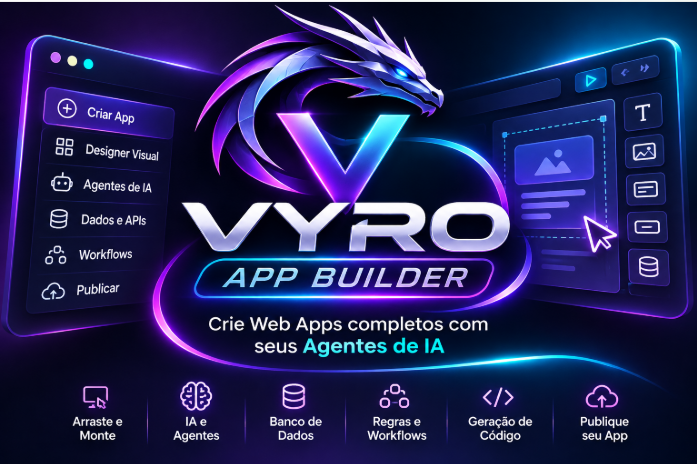

<div align="center">



# VYRO App Builder

**Editor visual open source para desenhar interfaces e evoluir para a criação de aplicações web completas.**

[](LICENSE)
[](https://nextjs.org/)
[](https://react.dev/)
[](#estado-atual-do-projeto)

**[Instalação](#instalação-passo-a-passo) · [Como usar](#primeiros-passos-no-editor) · [Roadmap](#roadmap) · [Manuais](#documentação) · [Licença](#licença-e-uso-comercial)**

</div>

> **Atenção:** este projeto é um fork do [M3E Canvas](https://github.com/lnkiai/m3e-canvas). A versão atual ainda é principalmente um editor de interfaces Material 3 Expressive e gerador de prompts para ferramentas de IA. **Não é, neste momento, um concorrente funcional completo do Bubble ou FlutterFlow.** Os recursos de banco de dados, CRUD full stack, publicação e orquestração de agentes fazem parte do roadmap.

## Visão

Queremos que desenvolvedores, estudantes, freelancers e pequenas software houses possam criar interfaces, evoluir para sistemas web funcionais, exportar seu código e comercializar os aplicativos desenvolvidos. O **VYRO App Builder** continuará open source; os sistemas criados com ele podem ser distribuídos comercialmente conforme as licenças dos componentes utilizados.

## Estado atual do projeto

| Recurso | Estado | Observações |
| --- | --- | --- |
| Editor visual Material 3 Expressive | Disponível na base original | Componentes, telas e propriedades |
| Pré-visualização e navegação entre telas | Disponível na base original | Simulação de fluxos de interface |
| Temas, cores e camadas | Disponível na base original | Personalização visual |
| Geração de prompts para IA | Disponível na base original | **Não equivale à exportação de um sistema completo** |
| Assistentes opcionais de IA | Disponível na base original | OpenAI, Claude, Gemini e DeepSeek; dependem de configuração |
| Tradução completa para português brasileiro | Planejado | Interface original possui outros idiomas |
| Exportação de projetos web completos | Planejado | HTML/CSS/JS e React |
| CRUD visual com banco de dados | Planejado | Backend e persistência reais |
| Orquestração de agentes e Ollama | Planejado | Integração supervisionada |
| Publicação e hospedagem de aplicativos | Planejado | Requer infraestrutura e segurança |

## Requisitos

- **Node.js:** `^22.12.0 || ^24.0.0 || >=26.0.0` (conforme `package.json`).
- **npm:** instalado com o Node.js.
- **Git:** recomendado para clonar e atualizar.
- Navegador moderno (Chrome, Edge, Firefox ou equivalente).
- Windows, Linux ou macOS com ambiente Node.js compatível.

> **Não é necessário instalar XAMPP, PHP ou MySQL** para executar o editor atual. Essas tecnologias podem ser usadas futuramente em aplicações geradas, conforme a arquitetura escolhida.

## Instalação passo a passo

### Opção A — Windows (PowerShell)

1. Instale o Node.js compatível em https://nodejs.org/ e o Git em https://git-scm.com/.
2. Abra o PowerShell e confira as versões:

```powershell
node --version
npm --version
git --version
```

3. Clone o fork e entre na pasta:

```powershell
git clone https://github.com/WalneyNF/VYRO-App-Builder.git
cd VYRO-App-Builder
```

4. Instale exatamente as dependências do arquivo de lock:

```powershell
npm ci
```

5. Inicie o servidor de desenvolvimento:

```powershell
npm run dev
```

6. Abra **http://localhost:3000** (ou a porta informada no terminal). Para encerrar, pressione **Ctrl+C**.

### Opção B — Linux / macOS

```bash
git clone https://github.com/WalneyNF/VYRO-App-Builder.git
cd VYRO-App-Builder
npm ci
npm run dev
```

Acesse o endereço local informado pelo Next.js.

### Usando a cópia já instalada no computador do mantenedor

```powershell
cd D:\VYRO-App-Builder
npm run dev
```

Se a porta 3000 estiver ocupada, o Next.js pode oferecer outra porta. Confira sempre a saída do terminal.

## Primeiros passos no editor

1. **Crie ou selecione uma tela** para celular ou desktop.
2. **Adicione componentes** pelo painel de peças: botões, textos, campos, cartões e outros elementos.
3. **Edite propriedades** como textos, dimensões, cores e aparência.
4. **Organize as camadas** e configure ações de navegação entre telas.
5. **Use a pré-visualização** para testar o fluxo de interface.
6. **Salve ou compartilhe o desenho** usando os recursos existentes.
7. **Gere um prompt**, quando desejar enviar a descrição da interface a uma ferramenta de programação com IA.

**Importante:** a pré-visualização de um formulário não implica que exista um banco de dados por trás dele. Persistência e API são etapas futuras do VYRO.

## Comandos úteis

| Comando | Finalidade |
| --- | --- |
| `npm ci` | Instala dependências conforme o lockfile |
| `npm run dev` | Inicia o editor para desenvolvimento |
| `npm run typecheck` | Verifica tipos TypeScript |
| `npm test` | Executa testes com Vitest |
| `npm run build` | Gera a versão estática de produção |
| `npm run start` | Serve a pasta `out` gerada pelo build |

### Compilar e testar antes de publicar

```powershell
npm run typecheck
npm test
npm run build
```

O projeto usa exportação estática do Next.js (`output: "export"`). Para hospedar, publique o conteúdo da pasta `out` em um servidor de arquivos estáticos. O script `npm run start` serve essa pasta localmente, **não inicia um backend de produção**.

### GitHub Pages

Para publicar em um site de projeto do GitHub Pages, o `next.config.ts` aceita a variável `NEXT_PUBLIC_BASE_PATH`. No PowerShell:

```powershell
$env:NEXT_PUBLIC_BASE_PATH = "/VYRO-App-Builder"
npm run build
```

Configure o deploy da pasta `out` de acordo com o fluxo de publicação escolhido. **Não considere o GitHub Pages como hospedagem de banco de dados ou API**: ele publica arquivos estáticos.

## Estrutura principal

```text
VYRO-App-Builder/
├── app/                 # Páginas, layout e editor Next.js
├── components/          # Painéis e componentes visuais
├── lib/                 # Modelos, internacionalização, IA e utilitários
├── public/              # Recursos estáticos do aplicativo
├── docs/                # Imagens e documentação complementar
│   └── vyro/
│       └── logo.svg     # Marca textual alternativa
├── manuais/             # Guias em português brasileiro
├── LICENSE              # Licença MIT original
├── NOTICE               # Atribuições de componentes de terceiros
└── package.json         # Dependências e comandos
```

## Solução de problemas

**`node` ou `npm` não é reconhecido:** reinstale o Node.js, feche e reabra o terminal e verifique `node --version`.

**Erro ao executar scripts no PowerShell:** experimente `npm.cmd ci` e `npm.cmd run dev`; não é necessário desativar indiscriminadamente a política de execução.

**Porta 3000 ocupada:** use a porta que aparecer no terminal ou encerre o processo anterior.

**Dependências inconsistentes:** confira a versão do Node.js e execute `npm ci` novamente. Evite apagar o lockfile sem necessidade.

**Erro no build:** execute `npm run typecheck`, `npm test` e consulte o erro exato no terminal antes de alterar dependências.

**O editor não gera banco de dados:** isso ainda não foi implementado; veja o roadmap.

**Chaves de IA:** a base original guarda configurações no armazenamento local do navegador. Não coloque segredos de clientes ou chaves de produção em máquinas compartilhadas; a arquitetura comercial futura exigirá proteção no backend.

## Roadmap

- **0.1 — Fundação:** identidade VYRO, documentação, português brasileiro e testes.
- **0.2 — Código exportável:** projetos HTML/CSS/JS e React independentes do editor.
- **0.3 — Sistemas reais:** formulários, CRUD, API, SQLite e migrações.
- **0.4 — Agentes:** orquestrador, revisão, aprovação e testes automáticos.
- **0.5 — Workflows e publicação:** autenticação, ações, implantação e backups.
- **1.0 — Produto consolidado:** templates, exemplos comerciais, manuais e qualidade verificada.

As versões acima representam **metas**, não entregas concluídas.

## Documentação

- [Comece aqui](manuais/00-LEIA-PRIMEIRO.md)
- [Licença e modelos de negócio](manuais/01-LICENCA-E-NEGOCIOS.md)
- [Arquitetura e segurança](manuais/02-ARQUITETURA-E-SEGURANCA.md)
- [Roadmap e critérios de aceitação](manuais/03-ROADMAP-E-CRITERIOS.md)
- [Guia do criador](manuais/04-GUIA-DO-CRIADOR.md)

## Licença e uso comercial

O projeto é derivado de **M3E Canvas**, licenciado sob [MIT](LICENSE), com copyright original de **lnkiai**. A MIT permite uso, modificação e distribuição comercial, exigindo a preservação dos avisos de licença e copyright nas cópias ou partes substanciais distribuídas. Consulte também o arquivo [NOTICE](NOTICE) e as licenças das dependências e recursos incorporados.

**Você pode desenvolver e vender aplicações usando a ferramenta.** Contudo, imagens, fontes, bibliotecas, templates e outros recursos utilizados nessas aplicações podem ter obrigações próprias. Faça uma auditoria de licenças antes da distribuição comercial.

## Contribuições e comunidade

Sugestões, relatórios de bugs, documentação e contribuições de código são bem-vindos. Antes de abrir um pull request, execute:

```bash
npm run typecheck
npm test
npm run build
```

Descreva o problema, o comportamento esperado, os arquivos alterados e os testes realizados. Não inclua credenciais, informações privadas de clientes ou arquivos gerados com dados sensíveis.

## Créditos

**VYRO App Builder — Walney Moreira Klein — walneyk@hotmail.com**

Fork e evolução do projeto original [M3E Canvas, de lnkiai](https://github.com/lnkiai/m3e-canvas). Créditos, direitos e licenças dos autores originais permanecem preservados em [LICENSE](LICENSE) e [NOTICE](NOTICE).

> A imagem oficial do projeto é a arte com dragão e interface neon, em `logo.png`.
